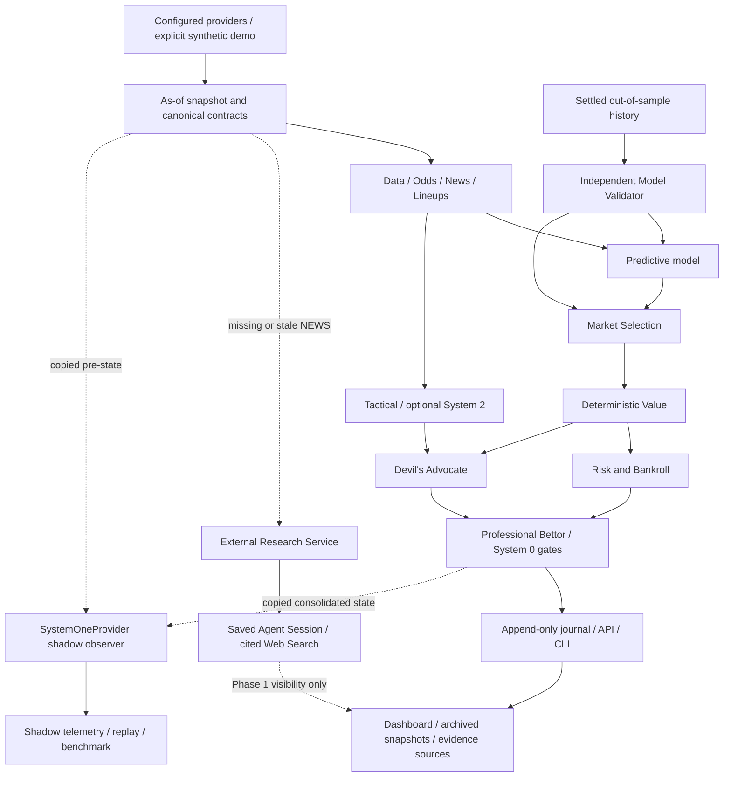

# Architecture

Current 0.2.0: the 888 profile uses 888 for match identity, competition, kickoff, odds and markets. Two saved agents have disjoint scopes: Football Data Research obtains current quantitative observations for Serie A/B/C, while External Research obtains qualitative pre-match context. Their outputs are validated separately and stored in distinct `EnrichedSnapshot` sections. Raw recent matches are converted deterministically into W/D/L, GF/GA, scoring averages, BTTS and Over 2.5. Agents never call OpenAI. Historical model validation remains separate. Sportradar adapters and tests are retained, but Sportradar is absent from the default 888 runtime path. The catalogue requires verified native competition IDs as well as compatible labels. See [research architecture](research-agents.md).

Runtime 0.1.3 reuses append-only annotations for a user-declared bank ledger and historical StatsBomb import metadata. Bank snapshots are projected as-of into existing Portfolio/Position contracts only when no external portfolio is supplied. Exact stakes and settlement timestamps preserve current exposure and historical turnover separately. StatsBomb is a research archive, not an automatic live-source or model-validation override. See [Banca and StatsBomb](bank-and-statsbomb.md).

The optional `config/888` profile binds fixtures and odds to the public 888 Italy offering adapter, with a separate local database. Sportradar and API-Football are not selected by that profile. Numerical statistics may remain unavailable until a separate structured or historical source is configured; their absence is typed missing data. Native team/competition IDs are preserved. See [888 integration](provider-888.md).

Bettor separates functional levels (collection, analysis, control, decision) from computation (System 0, System One, System 2). System 0 owns all numeric values and final gates. Agents never vote. Model probability, semantic confidence and decision confidence are different contracts.

Pydantic contracts reject unknown fields, nonfinite values and naive timestamps. Providers return canonical snapshots with source provenance. The explicit dependency graph scopes agent inputs; independent collectors execute concurrently. Partial provider failure becomes a typed unavailable result, never a fabricated prediction. Critical failures prevent BET.

The quantitative baseline derives goal rates from observed team summaries and produces reproducible distributions. The independent Validator evaluates historical out-of-sample records. Value and risk propagate its reliability; an unavailable validation history cannot authorize a BET. Betting journal entries are append-only; post-match observations and annotations are separate events.

SystemOneProvider is optional. The Rizzo adapter alone knows the vendor wire format. Shadow hooks record suggestions and actual actions without modifying the real agent graph, probability, stake, confidence or decision. System 2 consumes untrusted source material as data and returns validated qualitative evidence; it cannot calculate or overwrite critical mathematics.

SQLite is the zero-service development backend; SQLAlchemy and Alembic provide the migration boundary for PostgreSQL. No execution module places bets or handles real money. Synthetic demonstrations are prominently identified and are not sports advice or live data.

The same FastAPI process serves the browser dashboard at `/` and local assets at `/assets`. Native ES modules consume typed API output, saved analysis summaries and public workspace metadata. The browser owns presentation only; no financial formulas or decision rules are duplicated. Explicit demo requests use isolated fresh synthetic bundles through the existing orchestrator and are rejected outside demo startup. See [dashboard](dashboard.md).

For live requests without an explicit as-of, collection finishes before the decision cutoff is frozen. Historical requests keep their explicit cutoff and reject later data. The shadow observer evaluates copied pre/post states after the real decision, so neither its latency nor its recommendations changes actual scheduling/freshness. Independent agent contexts contain only graph dependencies.
